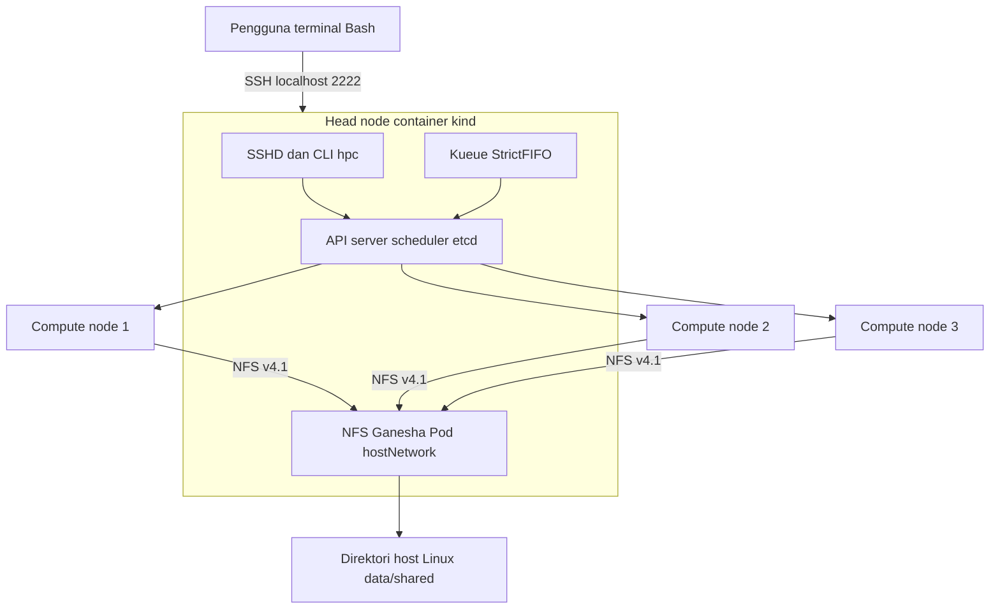

# Arsitektur dan batasan

Proyek mengikuti dokumen awal: satu head node mengelola tiga compute node dalam cluster kind pada satu Docker Engine. Ketersediaan yang diuji adalah penyelesaian ulang pekerjaan saat compute node mati. Seluruh node tetap berbagi host fisik yang sama.

## Pembagian komponen

Head memakai label `hpc.local/role=head`. NFS dan controller Kueue dipasang ke head dengan nodeSelector dan toleration control plane. SSH terpasang sebagai service systemd dalam container head, bukan container node tambahan. Dengan demikian tetap ada tepat empat container node kind; Pod NFS berjalan di container runtime internal head.

Worker memakai label `hpc.local/role=compute`. Template Job memiliki nodeSelector tersebut dan tidak memiliki toleration control plane. Kubernetes tetap mengelola jaringan dan DNS dengan komponen bawaan kind. Pod sistem dapat menggunakan worker; anggaran allocatable menyertakan kebutuhan mereka.

NFS Ganesha menyediakan implementasi server userspace melalui VFS; layanan berjalan di network namespace head pada TCP 2049. PV menggunakan IP internal head dan ekspor `/shared`. Seluruh worker melakukan mount lewat NFS; direktori host tidak di-bind langsung ke worker. Direktori yang sama dapat dibaca akun SSH melalui `/srv/hpc`. NFS bukan storage dengan HA atau replikasi. Image NFS privileged dibatasi pada lab lokal.

## Pengiriman dan penjadwalan

CLI membuat `batch/v1 Job` dengan `suspend: true` dan label LocalQueue `hpc`. Kueue mengelola Workload dan menerima pekerjaan berdasarkan kuota ClusterQueue `hpc-queue`. ResourceFlavor menghubungkan kuota ke worker melalui label. Setelah admission, Kubernetes menentukan worker.

Semua pekerjaan menggunakan prioritas yang sama. StrictFIFO mengurutkan penerimaan Workload sesuai waktu pembuatannya; bukan jaminan urutan mulai atau selesai Job. Requests CPU/memori menjadi dasar kuota. Topology spread memakai `ScheduleAnyway` agar distribusi diupayakan tanpa menghalangi failover ketika worker berkurang. Tidak ada jaminan round robin atau pemerataan hasil kumulatif secara persis.

Dengan anggaran default 800m CPU per worker dan request 500m per pekerjaan, dua pekerjaan tidak muat bersamaan pada worker yang sama. Kuota 1500m CPU/384 MiB memungkinkan paling banyak tiga pekerjaan default admitted, bergantung pada kesiapan dan kebijakan controller. Saat satu worker mati, kapasitas eksekusi berkurang; job admitted bisa Pending sampai worker lain bebas.

## Batas sumber daya

`docker update` menerapkan quota CPU dan hard memory limit node. Node kind dapat melaporkan kapasitas host kepada scheduler. Karena itu skrip menghitung `kubeReserved` worker dari kapasitas yang dilaporkan dikurangi target anggaran Pod. Kubelet kemudian mengiklankan allocatable yang sesuai dan membatasi cgroup Pod.

`evictionHard.memory.available` worker diatur `0Mi` khusus lab agar reservasi memori tidak dihitung dua kali terhadap anggaran Pod yang kecil; hard limit Docker tetap berlaku. Ini meningkatkan risiko OOM saat beban melebihi anggaran. Head mempertahankan konfigurasi allocatable bawaan dan hanya diberi hard limit Docker; pekerjaan pengguna tidak dijadwalkan ke head. Konfigurasi ini adalah penyesuaian kind untuk eksperimen, bukan resep cluster produksi.

## Pemulihan pekerjaan

Job menggunakan `restartPolicy: Never`, `podReplacementPolicy: Failed`, `backoffLimit: 6`, serta batas waktu aktif 1800 detik. Toleration `not-ready`/`unreachable` adalah 30 detik. Waktu deteksi node mati dan pemrosesan controller tetap menambah latensi; 30 detik bukan janji waktu pemulihan total.

Kueue dijalankan dengan feature gate `FailureRecoveryPolicy=true`. Template Pod secara eksplisit memberi anotasi `kueue.x-k8s.io/safe-to-forcefully-delete: "true"`. Controller ini mengubah Pod yang tertahan terminating di node unreachable menjadi Failed setelah masa tunggunya. Job controller membuat Pod pengganti pada worker yang masih tersedia. Tidak perlu submit ulang, menghapus Job, atau menghapus finalizer secara manual.

Fitur tersebut masih Alpha pada versi yang ditetapkan. Ia dipakai hanya untuk pekerjaan independen yang aman dijalankan ulang: setiap Pod menulis ke direktori UID berbeda, tanpa efek samping eksternal atau berkas hasil bersama yang ditimpa. Simulasi menghentikan container worker dengan timeout nol, sehingga proses lama benar-benar dihentikan. Jangan menganggap pola ini menjamin exactly-once untuk aplikasi lain atau aman untuk network partition dengan penulis data bersama.

Perhitungan selalu dimulai ulang. Tidak ada checkpoint atau migrasi proses hidup. Berkas parsial tidak dianggap sebagai hasil sukses; hanya `result.json` dengan `verified: true` yang menyatakan keluaran terverifikasi. Kondisi Job `Complete` juga harus diperiksa untuk keberhasilan cluster.

## Batasan evaluasi

Head, NFS, host Docker, dan laptop adalah titik tunggal kegagalan. Tidak ada pengujian kegagalan head, storage failover, multi-control-plane, MPI, GPU, atau autoscaling. Batas memori head 1 GiB perlu dibuktikan pada lingkungan aktual dan mungkin perlu dinaikkan.

Log menggunakan timestamp UTC. Node berbagi kernel/clock host, sehingga perbandingan antar-node menggunakan clock host yang sama. Eksperimen mengukur perilaku orkestrasi lokal; hasilnya tidak mewakili jaringan atau performa cluster fisik terpisah.

Rujukan perilaku: [konfigurasi kind](https://kind.sigs.k8s.io/docs/user/configuration/), [Kueue ClusterQueue](https://kueue.sigs.k8s.io/docs/concepts/cluster_queue/), [Kueue failure recovery](https://kueue.sigs.k8s.io/docs/tasks/manage/setup_failure_recovery/), [feature gate pada rilis yang dipakai](https://github.com/kubernetes-sigs/kueue/blob/v0.20.4/pkg/features/kube_features.go), [Job replacement policy](https://kubernetes.io/docs/concepts/workloads/controllers/job/), dan [Node Allocatable](https://kubernetes.io/docs/tasks/administer-cluster/reserve-compute-resources/).
